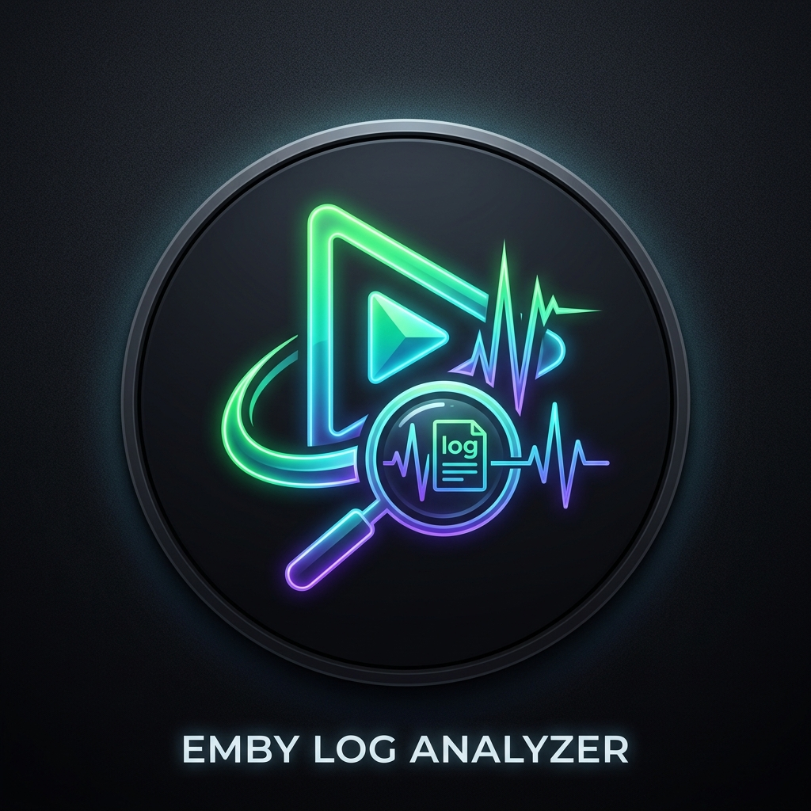

# Emby Log Analyzer

<p align="center">
  
</p>

<p align="center">
  <strong>High-performance cross-platform desktop application and correlation engine for Emby Server and FFmpeg transcode logs.</strong>
</p>

<p align="center">
  
  
  
  
</p>

---

## 🌟 Overview

**Emby Log Analyzer** solves one of the most frustrating challenges for home media administrators: diagnosing why a media playback session froze, buffered excessively, crashed, or terminated unexpectedly. 

By analyzing **Emby Server logs** (`embyserver*.txt`) and **FFmpeg transcoding logs** (`ffmpeg-transcode-*.txt`) simultaneously, the analyzer intelligently correlates processes and determines:
- Whether playback was **Direct Play**, **Direct Stream**, or **Transcoded**.
- Which specific FFmpeg transcode worker belonged to which Emby playback session.
- What the true root cause was (hardware acceleration crash, network drop, storage partition full, filesystem permissions, corrupted media, or codec mismatch).
- A calculated **confidence score** (0–100%) backed by raw log evidence.
- Actionable, step-by-step troubleshooting recommendations.

## Project ecosystem

- [Agent instructions](AGENTS.md)
- [Project profile](https://github.com/Eidolf/ER-KnowledgeBase/blob/main/Projects/ER-Emby-LogAnalyzer/README.md) (private)
- [Knowledge-Platform](https://github.com/Eidolf/Knowledge-Platform)

---

## ✨ Key Features

- **Automated Multi-Log Correlation**: Links sessions across disparate files using session IDs, play session tokens, transcode job hashes, and timestamp alignment.
- **Root Cause Diagnostic Engine**: Categorizes failures across:
  - **Hardware Acceleration**: NVIDIA NVENC, Intel QuickSync (QSV), Linux VAAPI, AMD AMF, CUDA.
  - **Storage & Disk I/O**: Transcode temporary cache exhaustion (`No space left on device`).
  - **Permissions**: Read/write access denials (`EACCES` / `Access is denied`).
  - **Network & Client Interruption**: Client disconnections, Wi-Fi drops, reverse proxy timeouts.
  - **Codecs & Media Bitstreams**: Corrupted MKV headers, missing moov atoms, unsupported pixel formats.
- **Privacy-First Local AI Explanation**: Generates plain-language executive summaries locally without transmitting log data to third-party cloud services.
- **Chronological Timeline Reconstruction**: Merges server events and transcoder execution traces into an interactive visual timeline.
- **Multi-Format Exporting**: One-click reports in **HTML**, **Markdown**, and **JSON**.
- **Modern Dark Desktop GUI**: High-tech interface with drag-and-drop ingestion, interactive confidence gauges, and status badges.
- **Headless CLI Utility**: Automate diagnostics on headless Linux servers or CI pipelines via `node cli/cli.js`.
- **Extensible Knowledge Base**: Customize and expand diagnostic rules via JSON (`src/engine/kb/rules.json`).

### Guided diagnosis by task

The sidebar now starts with diagnosis goals rather than requiring users to understand every data source:

1. **Playback logs / no device access**: choose **Select local server / FFmpeg logs**, or **Load server logs via API**. The API shortcut opens **Settings → Server logs**; a saved connection/key and Emby administrator permission are prerequisites. Listing and downloading remain explicit actions.
2. **Mobile device test**: follow the preparation checklist, enable Android app diagnostics before any necessary repeat, record times/time zone and separate audio/video quality settings, then **Attach Android app log**. Android-only input is supported; retain matching server/FFmpeg logs when available. The Emby server API cannot download client logs.
3. **Compare API captures**: configure a saved connection, annotate the test conditions and open the existing capture controls. Captures fetch their own data and remain independent of live snapshots; they are optional evidence, not a prerequisite for log analysis.
4. **Review findings / next steps**: after analysis, jump back to the evidence summary, observations and suggested follow-up. Detailed request/client events are expandable instead of filling the main results view. HTML/Markdown/JSON exports include the evidence guidance.

Switching diagnosis paths does not clear selected files, results or captures. Adding or removing files requires **Analyze logs** again; reports and captures must be explicitly exported before closing. A client-only analysis without extracted server sessions displays **Not assessed**, not a server-health verdict; the underlying engine findings remain unchanged. Missing server logs are distinguished from zero recognized server requests. No Android repeat or server Debug logging is mandatory just because those sources are absent.

### Optional live Emby API snapshot

Open **Settings → Emby connections** to add or select a server. **Test public URL** calls only `GET /System/Info/Public`; a successful test does **not** validate credentials or session permissions. Fetching a snapshot requires a saved API key or access token.

| Read-only endpoint | When called | Diagnostic value |
| --- | --- | --- |
| `GET /System/Info/Public` | URL test or snapshot | Server identity and version |
| `GET /Sessions` | Snapshot | Connected, playing, paused and idle sessions; client/device metadata; server-reported transcoding details |
| `GET /System/Info` | Explicitly selected before fetching | OS display name, pending restart and shutdown flags; no configuration changes |
| `GET /System/ActivityLog/Entries?StartIndex=0&Limit=50` | Explicitly selected before fetching; requires administrator permission | First page of activity names, timestamps, types and severities; at most 50 entries, no pagination |
| `GET /System/Logs` | Explicitly selected in Settings; requires administrator permission | Lists Emby and FFmpeg log file names, sizes and modification times |
| `GET /System/Logs/Log?Name=<selected filename>` | Explicitly selected in Settings; requires administrator permission | Downloads a selected server log to local temporary storage for analysis |

The main content area shows the timestamped snapshot separately from log-derived findings. Session details include session/device IDs, client version, remote endpoint, last activity, codecs, raw **TranscodeReasons**, decoder/encoder names and hardware flags, output bitrate, transcode framerate and transcoder CPU usage when supplied by Emby. Audio context includes item/source container, candidate audio-stream codec, bitrate, sample rate, bit depth and channels, selected stream index, position, queue item/index/length, repeat, shuffle and sleep-timer settings. Fields may be absent. Item/source streams describe available metadata, not necessarily the actual selected or output stream. Missing pause/hardware flags stay **unknown**, not playing states or software failures. Session visibility depends on the token's permissions. Copied video is excluded from hardware/software encoding counts; audio-only transcoding is not a GPU diagnosis, and software encoding alone is not diagnosed as a fault. These are server-reported observations, not GPU inventory, driver validation or evidence of a hardware defect.

If an optional system/activity request is denied, unsupported, malformed or times out, the core snapshot remains available with a visible warning and per-endpoint status. Failure of public info or sessions fails the snapshot; unavailable data is never presented as an empty successful result. A failed new snapshot request removes the previous snapshot rather than silently exporting stale data. Changing the server URL or pressing **Clear** also removes it from the current report.

**Reporting:** HTML, Markdown and JSON exports work with the API snapshot or manual comparison alone, without selecting log files. After local analysis, the same exports can include these sources in separate sections. API-only reports do not manufacture log health scores. Capture time, endpoint status, warnings and activity-page scope are retained. **Clear** removes the live snapshot; **Clear captures** separately removes previously captured comparison evidence. Reports can contain usernames, media titles, device/user/item IDs, addresses and activity names: review them before sharing.

**Transport and credentials:** Requests run in Electron Main through a narrow preload/IPC interface. API keys are encrypted with Electron `safeStorage` and are never returned to the renderer or added to reports. Connection metadata is stored in a local JSON settings file. In portable Windows builds, that file is kept under `PORTABLE_EXECUTABLE_DIR/EmbyLogAnalyzerData`; the encrypted key is bound to the current OS account and cannot be carried to another machine. On Linux, persistent key storage is enabled only with a supported Secret Service/KWallet backend. If the OS keyring is unavailable, the key remains in memory until the app closes and is never written to disk. Public requests send no token. HTTP is still supported for local installations but produces an unencrypted-transport warning; prefer HTTPS with a trusted certificate. Redirects are rejected and TLS certificate validation is not bypassed. Snapshot/list responses are limited to 2 MiB; each selected log download is limited to 50 MiB, with up to 20 files and 100 MiB total per request. Downloaded logs are written with owner-only permissions where supported, remain local in a temporary directory, and are removed when the application exits. Emby logs may contain API keys in request URLs and other private details; review exports before sharing. The app sends only GET requests for log retrieval and never uploads logs.

**Intentionally out of scope:** No polling, background service, playback control, server/library/user changes, automatic historical session matching or PlaybackInfo calls. PlaybackInfo predicts compatibility for a supplied playback context and is not proof of the actual active transcode; fuzzy matching by title/user could attach live facts to the wrong log session. Activity history is limited to the requested page, and permissions/server versions can affect field availability. Log retrieval is read-only but requires an administrator credential; only log files explicitly selected by the user are downloaded.

The analysis engine and CLI import no API client and remain usable offline. The desktop app adds request-level server evidence and common Android logcat parsing in a separate integration layer; these observations do not change the engine's root-cause findings. The shared comparison helper operates on data in memory and performs no network access. No database, cloud component or new dependency is introduced.

Endpoint references: [Sessions](https://dev.emby.media/reference/RestAPI/SessionsService/getSessions.html), [System info](https://dev.emby.media/reference/RestAPI/SystemService/getSystemInfo.html), [Activity log](https://dev.emby.media/reference/RestAPI/ActivityLogService/getSystemActivitylogEntries.html), [Emby log routes and Admin authorization](https://github.com/MediaBrowser/Emby/blob/1d7c2ab4bfebdae31f89fdaabd3b68782ccf495a/MediaBrowser.Api/System/SystemService.cs#L62-L80).

### Collecting server and Android client evidence

1. In **Settings → Server logs**, choose a saved connection whose token has Emby administrator permission, list available log files, and select the Emby/FFmpeg files covering the test time. Downloading them also runs the analysis; logs are never fetched in the background.
2. The result separates server-observed audio requests/responses from client-side evidence. Responses that complete after a client disconnect are counted separately from HTTP 4xx/5xx responses; when Emby logs no status code, the report preserves that as unknown. An HTTP 200 for a playlist does not establish that Android requested a media segment, decoded it or produced audible playback.
3. If client evidence is still missing, enable diagnostic logging in the Emby Android app **before** the test, repeat the same A/B/C sequence, note exact timestamps and time zone, then use **Attach Android app log** and analyze again. Common Android logcat formats and the Emby Android diagnostic-export format (including its GMT offset and multiline player errors) are parsed separately; unrecognized files are flagged instead of being treated as server logs.
4. Server Debug logging is not a substitute for Android logs. Use it only for a short repeat if the ordinary server log does not show the relevant request/response; disable it after the test. The app does not change server logging settings.

The supplied Emby Android 3.5.72 export was verified and is now recognized. Other app versions or localized export formats may differ; if a file is flagged as unsupported, keep the original and provide it for format-specific support. A parsed client error is evidence of a player failure, not by itself proof of whether the server response, network path or client parser caused it.

### Manual scenario comparison and playback evidence

1. Select a saved Emby connection in **Settings**; optionally enable system information and the first activity-log page.
2. Expand **Capture A / B / C scenario**, enter a label and annotate the observed network, playback start surface and outcome. These are **administrator observations**, not automatically detected API facts.
3. Press **Capture scenario** for each A/B/C point. Each press performs its own read-only API fetch and immediately saves an independent in-memory capture. If exactly one session is returned it is selected automatically; if several are returned, choose the intended session from that fresh response and it is saved on selection. A response with no sessions is captured as “none selected,” not as proof of session termination.
4. Repeat for the next condition. The live snapshot panel is not used or replaced by scenario captures.
5. Compare up to **six** captures side by side, including timestamp, identities, client/version, media IDs, PlayMethod, queue/position, source/audio metadata, output audio codec and TranscodeReasons. Differences are not automatically errors; unavailable and partially missing audio values remain unknown.
6. Export before closing the application. Captures are memory-only; connection profiles are separate settings, while snapshot import and session history are not provided.

Each capture deep-copies the selected session and the snapshot's server/activity context. Other sessions are not retained, and fleet summary counters are omitted from this selected subset. The original returned session count remains explicit. Activity entries remain **server-wide**, even when a session is selected. Captures intentionally survive clearing/replacing the live snapshot, failed subsequent requests and URL changes; use **Clear captures** to remove them from future exports.

Correlation confirms matching reported API session IDs only when a nonempty reported server ID also matches. An API session can span multiple tracks and is **not** a `PlaySessionId`. A missing session or identifier does not prove a session ended, and two manual captures do not prove uninterrupted playback. Network endpoints do not establish mobile versus WLAN; the same Android client name may appear for phone and Android Auto starts.

Offline analysis now retains separate playback-stop and server-session-end observations, reported position, device/media-source/play-session IDs and source line numbers where recognized. The explicitly reported log PlayMethod is retained separately from the legacy engine classification, which can infer transcoding from an associated FFmpeg job. Missing reported PlayMethod is **Unknown**, not assumed Direct Play. Missing errors, a stop or a session-end message do not establish natural track completion or successful queue advancement.

Recognized audio HTTP responses retain status and optional request duration, including partial-content responses. A long response can be normal streaming; neither duration nor HTTP 200/206 proves buffer starvation, startup latency or audible playback success. Raw audio request URLs are not copied into these new events. Explicit unknown playback IDs are not reassigned to another track; contextual single-session associations are marked, and unresolved events remain in a separate evidence section. HTML/Markdown/UI display at most 100 unassigned events (and 100 relevant events per exported log session); JSON retains all.

The legacy `AUDIO_TRANSFER_BUFFER_STARVATION` rule ID remains compatible, but its unsupported fixed timing/file-size/mobile-throttling explanation was replaced with a neutral audio-transfer/client-disconnect observation. The analyzer no longer claims normal completion merely because supplied logs contain no detected failure. These changes correct diagnostic overclaims, not the playback behavior of Emby.
Android application versions such as “Emby for Android 3.4” are no longer treated as Android OS 3. The OS observation requires an explicit client-OS/operating-system label and remains informational, not a decoder/TLS/queue-failure diagnosis.

### Investigating the reported FLAC/mobile case

**Evidence status:** The administrator supplied an Emby server log and two FFmpeg logs. The supplied copy masks API-key values. Server timestamps are local time at UTC+01:00; UTC times below are converted for correlation. No Android app log was included, so the client-side player/network cause is still unknown.

| Scenario | Reported conditions | Reported result |
| --- | --- | --- |
| A | Android phone app, mobile data, FLAC album | Stops after every second track; restarting the album or “play from here” is needed |
| B | Android phone app, WLAN, FLAC album | Works |
| C | Android Auto head unit, same mobile connection, playback started from car UI | Works |

The supplied server log disproves the hypothesis that the third-title request never reached Emby. Two server-side attempts for item `2754046` appear:

- At **00:21:43 UTC**, Emby received the Android `Audio/.../universal` request and reported `DirectPlay`; the response ended after the client disconnected, after about 15.2 seconds. This does not identify whether the app or the network closed the connection.
- At **00:51:33 UTC**, Emby received another request for that item and returned an HLS playlist with HTTP 200 in 6 ms. The server then logged playback start at position 26.849 s, followed about 0.3 seconds later by an app-reported stop at position 0 ms. No HLS media-segment GET for that PlaySessionId appears in the supplied server log, and no matching FFmpeg log was supplied.

The second sequence places the failure after Emby received the media request and returned the playlist, but before a media segment request is visible at the server. It does not prove whether the app rejected the playlist, failed to request a segment, or lost connectivity. The first attempt independently shows a stream ending on client disconnect. For this evidence set, additional Emby server Debug logging is not the next useful step: normal Info logs already include the relevant requests and responses. Android app diagnostics around a repeated test are the priority.

#### Available evidence and its limits

| Source | Available now | Not established by that source |
| --- | --- | --- |
| Existing API snapshot | Server identity/version/status, client/device/version, live state, PlayMethod, TranscodingInfo/TranscodeReasons and bounded activity | Historical track transitions, decoder errors on Android, natural completion |
| Newly retained `/Sessions` fields | Queue index/length/item, position, repeat/shuffle/sleep context, media-source/stream IDs and audio metadata when returned | Next-track request actually issued, gapless/prefetch state, mobile radio, launch UI; candidate source streams are not output codecs |
| Activity page | Entry ID, time, type, severity, name and supplied user/item IDs | Complete playback lifecycle; automatic association to a selected session |
| Supplied Emby/FFmpeg logs | Two requests for item `2754046`, one DirectPlay response completed after client disconnect (no HTTP status recorded), and a later HTTP 200 HLS playlist followed by app-reported stop; no segment GET in the latter sequence | Why Android stopped; whether the playlist was received/accepted or why no segment request followed |
| Android client logs and explicit test notes | Potential player/queue/decoder/OS lifecycle evidence, start UI, foreground/background and actual network context | Not present in the supplied log bundle and not available through the server API |
| Optional supplied proxy/access logs | Historical request status/range/cancellation clues if recorded | Client buffer state or success merely from an HTTP status |

Compare **reported** Direct Play, Direct Stream and Transcode; do not infer them from `.flac`. Source FLAC metadata and output AAC/other codec are different facts. A Direct Stream label alone does not establish that no audio conversion occurred. Audio-only transcodes are not evidence of failed video hardware acceleration.

#### Hypotheses, not diagnoses

| Unconfirmed possibility | Evidence needed to distinguish it |
| --- | --- |
| Queue advancement, prefetch/gapless, player lifecycle or background/power behavior differs by launch surface | Same-client A/B/C captures plus Android client logs around the last good → missing next track; note screen/background state |
| Remote quality/client profiles select a different playback or audio path | Compare actual PlayMethod, source ID/stream index, TranscodeReasons, output codec/bitrate and matching FFmpeg logs |
| Next-track HTTP/range requests are cancelled, fail or traverse a different proxy path | Timestamp-aligned server/client and, if available, proxy logs; distinguish request duration from startup latency |
| Per-track FLAC properties trigger a different client path | Identical item IDs and order across tests; compare sample rate, bit depth, channels, duration and reported/output codec at the failing boundary |

The “every second track” pattern makes track-boundary/queue evidence particularly valuable, but does not prove a queue or gapless defect.

#### Android app log and A/B/C snapshots supplied afterward

The supplied Android export uses local timestamps with `GMT+01:00`; the comparison report stores capture times in UTC. They align: captures A/B/C were at 02:52:24, 02:52:52 and 02:53:20 local time. A shows playlist item 0, “Descending,” playing at about 68 seconds; B shows item 1, “Black Mountain,” playing at about 11 seconds. Both snapshots report audio transcoding to AAC in an MPEG-TS container. At C, the selected session no longer has a current media item, while the playlist index is 2; this alone would not prove why it stopped.

The client log supplies the missing player-side evidence. Around **02:53:15.937 GMT+01:00**, Media3/ExoPlayer reported `ERROR_CODE_PARSING_CONTAINER_UNSUPPORTED` and `UnrecognizedInputFormatException` at media position 0 for playlist window 2, followed immediately by the Emby playback manager entering `STATE_ERROR` and `STATE_STOPPED`. That is consistent with the C capture and confirms a client-side media parsing failure while attempting the third playlist item. Earlier windows also log the same exception but subsequently enter `STATE_PLAYING`, so the exception alone is not enough to distinguish a recoverable retry from the final failure.

This narrows the investigation substantially, but does not identify the bad bytes or their source. The client export does not establish whether the response/segment was malformed, incomplete or altered in transit, or whether the app rejected a valid response. Correlate these exact client timestamps with the Emby Info-level request, response and segment entries for the same item/PlaySessionId; collect a matching FFmpeg log if transcoding was active. The supplied comparison report contains snapshots, not the server HTTP response body.

#### Follow-up: HLS fallback sequence and conditional audio-quality workaround

Subsequent client tests explicitly logged **Attempting to fallback to HLS playback** after the unsupported-container errors on the first two started titles; both then reached `STATE_PLAYING`. Another playlist window failed with the same container error and entered `STATE_ERROR` without an intervening fallback message. Changing the starting track moved the failing absolute playlist index: a particular title/index alone did not explain the behavior. An internal exhausted retry counter remains a hypothesis, not a verified Emby implementation defect.

Changing the **video** mobile quality did not change the audio-start URL's `MaxStreamingBitrate=1000001`. After both **audio** limits were explicitly raised to **4 Mbps**, a fresh test showed `MaxStreamingBitrate=4000000`, FLAC input and four `STATE_PLAYING` events, with no matching container errors or HLS fallbacks. This is a useful workaround observation for those files, not proof of a bandwidth shortage, a universal 4 Mbps requirement or reliable long-term/automatic queue playback. Decoder-side `audio/raw` is not uncompressed network transport.

The desktop evidence layer now recognizes a conservative version of this sequence: container failure → explicit HLS fallback → `STATE_PLAYING` on at least two distinct playlist windows, then another window's container failure → `STATE_ERROR` without a logged intervening fallback. It resets sequence tracking at ExoPlayer Init/Release, ordinary non-fallback playback and error boundaries; recoveries are never combined across files or player runs. Window numbers are identifiers, not counts of started titles. Historical matches in cumulative logs remain observations, not a claim that the latest run is still broken. Reports retain timestamps, file names and source line numbers for matched evidence.

Only this complete pattern produces the qualified audio-quality workaround: record the original settings, use an explicit **audio** limit above the affected source bitrate, restart the app, repeat under the same conditions, and verify the actual audio-start request in a fresh log. Four Mbps worked in the investigated case but is insufficient for some media and can increase mobile data use. Audio-request bitrate extraction retains only a numeric limit as structured metadata; URLs in the existing client text evidence remain credential-redacted. The report does not automatically equate a 4 Mbps request or absence of errors with a confirmed fix.

Isolated parser errors, unsupported exports and logs without the sequence get evidence-appropriate next steps rather than that workaround. Guidance is separate from the engine's root-cause rules and is included in desktop HTML, Markdown and JSON exports. Truncated client evidence is explicitly marked. No new dependency, server mutation, playback command or automatic logging/quality change is introduced.

#### Reproducible collection plan

- Use the same album, item IDs, track order and preferably at least three tracks for A/B/C. Record Emby/app versions, device ID, time zone/clock alignment, network, start UI, screen/background state and each manual recovery action.
- Start playback manually on the intended client. The analyzer sends **no playback command**.
- For each scenario, manually fetch/capture once before the critical second-track boundary and once immediately after the stall or successful next-track start: six captures total. Explicitly record “no selected session” if appropriate; do not treat disappearance as a proven end.
- Include the optional activity page if permissions permit. It can miss older events and is not an authoritative track history. Snapshot endpoints are independent concurrent requests, not an atomic server transaction; transitions between responses are possible.
- For a repeat, enable Emby Android app diagnostics before playback, then reproduce A/B/C and note the exact tap, stall, seek and stop times with the time zone. The supplied Android export is now supported; collect it immediately afterward, along with the time-matched Emby and related FFmpeg logs. The desktop tool can fetch server logs directly using the saved admin-authorized connection.
- Server Debug logging is not currently required for the observed requests. Use it only if a future Info-level server log lacks the relevant request/response rows. The analyzer never toggles that server setting.
- Preserve timestamps and IDs for private analysis; redact reports before sharing. Raw Emby logs may include API keys in query URLs, even though the supplied copy masks them.
- Export the comparison and offline report. Manually align server ID, device, item/media-source IDs, reported session IDs and times; do not equate API session IDs with playback IDs or match only by username/title.

**Next stage:** Correlate the newly parsed third-window ExoPlayer failure with the matching Emby request/response/segment logs. The desktop app recognizes the supplied Emby Android 3.5.72 export and common Android logcat formats; other export variants may still be flagged. No automatic fuzzy historical join or definitive FLAC failure detector is implemented.

**Remaining risks/open points:** Manual snapshots can miss short transitions; fields/permissions vary by server; selected-session captures still include sensitive server-wide activity; contextual log associations are weaker than explicit playback IDs; existing broader correlation/confidence heuristics are not statistically calibrated. Input logs can themselves contain credentials; exports are not a general-purpose log-redaction tool. Android Auto and other Android app-export variants remain unverified, and the server-side response/segment matching the new client error is still needed.

**Deliberately not implemented:** Polling/background monitoring, push/WebSockets, playback/configuration/library/user writes, PlaybackInfo, GPU inventory and automatic mobile/Android Auto detection. No available evidence justifies these additions for the current case.

### Workspace layout and theme

The desktop workspace separates tasks by intent: the left rail contains the diagnosis paths, log selection, the selected-file list and the analysis action; the main pane contains the guided checklist, log findings, API snapshots and scenario comparisons; report formats stay grouped in the header. Emby profiles, optional endpoint choices, public URL testing and explicit snapshot fetching live in **Settings**, keeping credentials and connection setup out of the analysis workspace. The settings dialog and the file rail scroll independently from the diagnostic results, including on shorter windows.

The sample-scenario loader has been removed from the desktop UI and its preload/IPC interface. Without a dedicated learning mode that highlights supporting log lines, mock scenarios add no operational evidence. The files under `test-datasets/` remain development regression fixtures; existing automated tests and CLI file input are unaffected.

The official **Observatory** theme uses a dark, low-glare slate foundation, restrained teal/cyan instrument accents and reserved green/amber/red semantics for diagnostic states. Consistent borders, spacing, focus states and responsive cards keep log evidence, point-in-time API observations and administrator annotations visually distinct. Future integrations can add grouped settings sections and main-pane diagnostic cards without adding more controls to the ingestion rail. The analyzer engine and its offline behavior are unchanged.

---

## 🚀 Getting Started

### Prerequisites
- Node.js (v18.0.0 or later)
- npm or yarn

### Installation
```bash
# Clone the repository
git clone https://github.com/ER-Emby-LogAnalyzer.git
cd ER-Emby-LogAnalyzer

# Install dependencies
npm install
```

### Running the Desktop GUI
```bash
npm start
```

### Running Headless CLI Mode
```bash
# Inspect logs and print diagnostic report to terminal
./cli/cli.js /path/to/embyserver.txt /path/to/ffmpeg-transcode-*.txt

# Export diagnostic report to HTML
./cli/cli.js -f html -o report.html ./test-datasets/03-failed-transcode-nvenc-driver-crash
```

### Running Automated Test Suite
```bash
npm test
```

---

## 📦 Building Executables

### Linux (AppImage / Standalone)
```bash
npm run build:linux
```

### Windows (.exe Portable / Installer)
```bash
npm run build:win
```

---

## 🧪 Included Test Datasets

The repository provides comprehensive test fixtures under `test-datasets/` covering standard scenarios:
1. `01-direct-play-success`: Direct play with clean session completion.
2. `02-hardware-transcode-nvenc-success`: NVIDIA NVENC accelerated transcode.
3. `03-failed-transcode-nvenc-driver-crash`: Driver initialization failure and CUDA crash.
4. `04-network-client-disconnect`: Remote client drop and socket interruption.
5. `05-storage-disk-full`: Transcode cache partition running out of disk space.
6. `06-corrupted-media-container`: Broken MKV/EBML headers and bitstream errors.
7. `07-permission-denied-transcode-temp`: Read-only cache or restricted permissions.
8. `08-qsv-hardware-failure`: Intel QuickSync `/dev/dri/renderD128` failure.

---

## 📄 License

This project is licensed under the MIT License - see the [LICENSE](LICENSE) file for details.

Copyright (c) 2026 **Eidolf**
